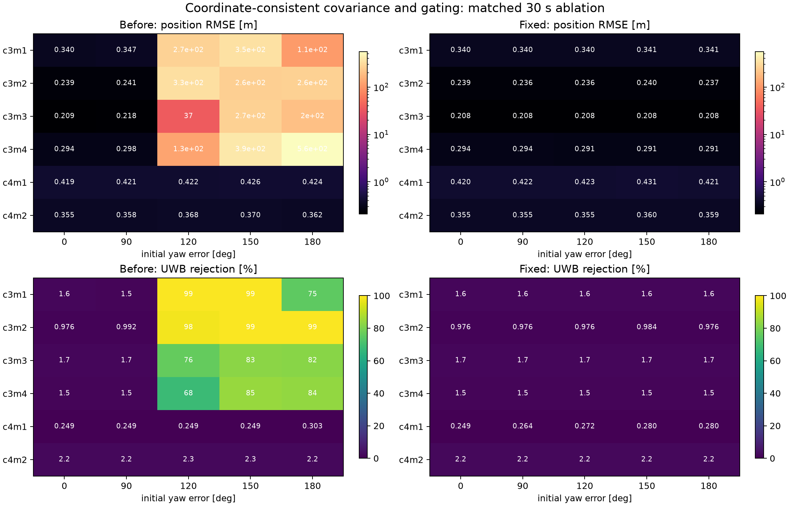
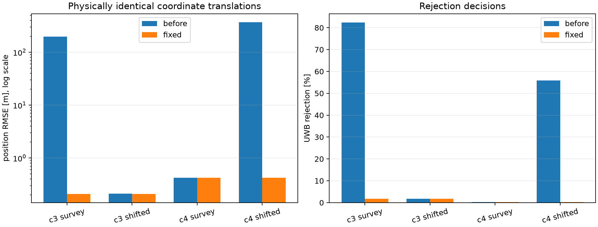
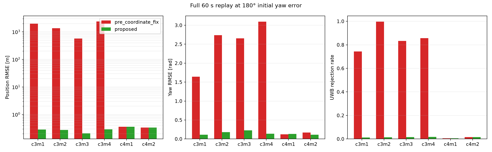

# 右不变协方差/门限一致性修复报告

日期：2026-07-23  
代码目录：`E:\0syncthing\Code\InEKF\imu-uwb-inekf`

## 1. 结论先行

这次定位到的问题不是后续改进新引入的；公开仓库的首个提交
`f3b664e0e8c86b62c6ed2ea2a112261810228e1c` 已经包含相关实现。

需要区分三件事：

1. **明确的原代码错误**：原代码先用左坐标测量雅可比 `H_left` 和右不变协方差
   `P_hat` 计算卡方门限，之后才执行 `H = H_left Ad(X_hat^-1)`。门限的两个量不在
   同一误差坐标中。这是代码错误，论文没有要求这样做。
2. **原代码的初始化遗漏**：代码把带有“姿态、速度、位置标准差”物理含义的对角阵
   直接作为右不变误差协方差。若该对角阵表达的是普通局部/物理先验，则必须先做
   Adjoint 协方差映射。论文定义了右不变误差，但未写明初始化映射；因此这是论文
   说明不完整叠加代码实现遗漏，不是 InEKF 理论本身错误。
3. **论文公式与代码不一致**：论文式 (38) 印为
   \(H^r=H^l\operatorname{Ad}_{\hat X}\)，公开代码实际使用
   \(\operatorname{Ad}_{\hat X^{-1}}\)。按论文式 (17)
   \(\eta^r=\hat X X^{-1}\) 以及左右误差关系
   \(\xi^l=\operatorname{Ad}_{X^{-1}}\xi^r\)，代码中的逆矩阵方向与这一推导一致；
   因此式 (38) 至少存在记号/漏写逆矩阵的疑点。它与本次“门限在变换前执行”的
   明确代码错误是两个不同问题。

此外，论文把 yaw 初始标准差设为 1 rad，却测试 180° 初差。180° 是该高斯先验的
3.14σ 事件，先验与“全圆未知航向”的试验假设不一致。修复坐标问题后，这个矛盾在
const4-manual1 的恰好 180° 条件下暴露出来。因此最终修复同时把全圆未知航向先验设为
2 rad，接近均匀分布 \([-\pi,\pi]\) 的标准差 \(\pi/\sqrt3=1.814\) rad。

## 2. 原提交中的直接证据

原 `scripts/estimation/inekf.py` 的顺序为：

```python
H = ...  # left-coordinate position Jacobian
M = H @ self.P_hat @ H.T + self.w_tdoa**2
if d_m >= 5:
    return ...  # reject before coordinate conversion

adj_X = ... SE3_2_adjoint(SE3_2_inv(self.X_hat)) ...
H = H @ adj_X
```

原 `scripts/estimation/main.py` 则直接构造对角 `P0` 后传给 `InEKF`，没有
Adjoint 映射。两段代码均来自上述 2024-08-25 的公开提交，不是本项目后续修改产生。

## 3. 修复内容

### 3.1 初始协方差映射

将普通物理/局部先验 \(P_l\) 转换为右不变误差协方差：

\[
H_r=H_l\operatorname{Ad}_{\hat X^{-1}},\qquad
P_r=\operatorname{Ad}_{\hat X}P_l\operatorname{Ad}_{\hat X}^{\mathsf T}.
\]

于是创新方差满足

\[
H_rP_rH_r^{\mathsf T}
=H_lP_lH_l^{\mathsf T},
\]

同一物理问题只改变世界坐标原点时，NIS 和拒绝决定不再改变。15 维状态中的偏置块
保持单位映射。

### 3.2 门限顺序

删除生产路径中的“变换前预门限”。先把测量雅可比转换到右不变误差坐标，然后只用
一次一致的创新统计量：

\[
S=H_rP_rH_r^{\mathsf T}+R,\qquad
\mathrm{NIS}=\frac{z^2}{S},\qquad
\mathrm{reject}\iff\mathrm{NIS}\ge25.
\]

`pre_coordinate_fix` 保留旧行为，仅用于严格配对消融。

### 3.3 全圆未知航向先验

生产 `proposed` 的默认 yaw 标准差从 1 rad 改为 2 rad。该变化不是用真实初差作弊：
它不读取真实 yaw，而是把“航向可能位于全圆任意位置”的先验显式化。调用 API 时仍可
通过 `initial_std_overrides` 指定其他已知先验。

### 3.4 测试

新增平移不变性单元测试：将机体和所有基站共同平移，确认修复后的 NIS 与拒绝决定在
数值精度内相同。当前测试结果为 **10/10 通过**，并通过 `compileall`。

## 4. 30 s 全角度配对网格

测试数据为 const3 manual1–4、const4 manual1–2；每条轨迹测试
0°、90°、120°、150°、180°，总计 60 次 before/after 回放。

修复前 const3 在 120°–180° 大面积失效，位置 RMSE 为 36.8–560.8 m，
UWB 拒绝率最高 99.49%。修复后全部 30 个“数据集×角度”条件的位置 RMSE 为
0.208–0.431 m，UWB 拒绝率为 0.249%–2.17%。



零初差下位置 RMSE 的相对变化为 -0.103% 至 +0.417%，没有位置精度回归；由于采用
全圆未知航向先验，部分零初差 yaw RMSE 比原先较窄的 1 rad 先验高约 0.04–0.15 rad，
这是更保守先验的明确代价，不应掩盖。

## 5. 坐标原点反事实测试

对同一物理轨迹同时平移 Vicon 位置和全部 UWB 基站：

- const3-manual3：修复前从 197.474 m 变为 0.211 m；修复后两种原点均为
  0.208252 m，拒绝率均为 1.7404%。
- const4-manual1：修复前从 0.424 m 变为 369.055 m；修复后两种原点均为
  0.421342 m，拒绝率均为 0.2797%。

这比单一数据集“跑通”更强：修复消除了物理上不应存在的世界原点依赖。



## 6. 完整 60 s、180° 初差复验

| 数据集 | 修复前位置 RMSE/m | 修复后位置 RMSE/m | 修复前 yaw RMSE/rad | 修复后 yaw RMSE/rad | 修复前/后拒绝率 |
|---|---:|---:|---:|---:|---:|
| c3m1 | 1983.350 | 0.283 | 1.644 | 0.112 | 74.39% / 1.19% |
| c3m2 | 1350.634 | 0.275 | 2.740 | 0.180 | 99.62% / 1.42% |
| c3m3 | **571.757** | **0.206** | 2.657 | 0.226 | **83.34% / 1.58%** |
| c3m4 | 2386.810 | 0.288 | 3.093 | 0.138 | 85.69% / 1.72% |
| c4m1 | 0.357 | 0.355 | 0.123 | 0.131 | 0.60% / 0.59% |
| c4m2 | 0.337 | 0.335 | 0.172 | 0.114 | 1.52% / 1.50% |



manual3 的代表性轨迹图显示：修复前轨迹离开真实区域数百米，位置误差单调增长且拒绝
计数持续锁死；修复后轨迹与 Vicon 重合，位置误差主要在 0.05–0.4 m 内，未发现跳变、
折返或数值爆炸。


## 7. 计算量

修复只增加一次初始化时的 15×15 协方差映射，并删除了每个 UWB 样本的一次重复预门限；
滤波循环的渐近复杂度不增加。并发 60 s 批处理中的平均回放时间为 before 23.04 s、
after 24.15 s（+4.8%），但各进程共享 CPU，单次值受调度影响；不能据此声称加速或
确定性变慢。新增初始化矩阵乘法相对于数万次 IMU/UWB 更新可忽略。

## 8. 文件

- 实现：`scripts/estimation/inekf.py`、`scripts/estimation/pipeline.py`
- CLI：`scripts/estimation/main.py`
- 单元测试：`tests/test_inekf.py`
- 30 s 网格：`experiments/run_coordinate_fix_ablation.py`
- 60 s 复验：`experiments/run_full60_coordinate_validation.py`
- 参数因果扫描：`experiments/run_covariance_scale_scan.py`
- 原始数值：`results/coordinate_fix_final/*.csv|json`、
  `results/coordinate_fix_full60/*.csv|json`

## 9. 限制

- 当前结论覆盖 6 条 manual 轨迹和 0°–180° 网格，不等同于对 UTIL 全部 trial 的统计证明。
- c3m3 修复后 60 s yaw RMSE 为 0.226 rad（约 13°），已从发散恢复且达到可用量级，
  但仍不是高精度航向；后续若要求长期小于 5°，需要增加航向可观测信息或更系统的圆周
  先验处理，不能通过缩小报告区间来宣称完成。
- 论文式 (38) 的 Adjoint 方向应在作者的完整残差/误差符号约定下重新排版澄清；本次
  没有为了“字面对应论文”而把已验证的逆矩阵方向改成正向。
