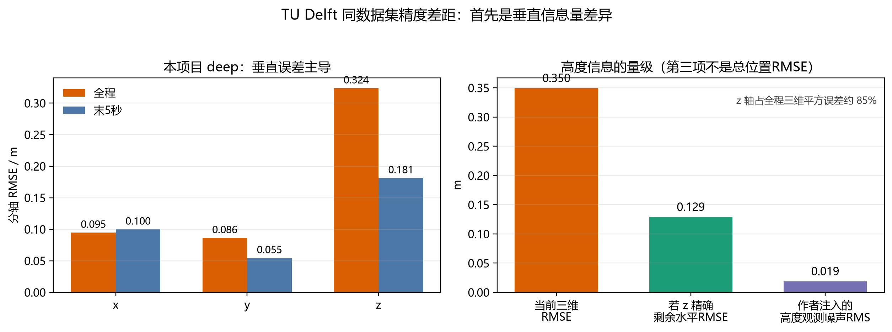

# Task06 同数据集精度差距与“真值辅助”分析

- 日期：2026-08-03
- 数据集：TU Delft `UWB dataset (Version 1)`，DOI `10.4121/14827680.v1`
- 当前正式结果：`imu-uwb-state-augment-deep-coupled-two-filters/results/deep_coupled_delay_full/real`
- 对照论文：Pfeiffer 等，RA-L 2021；IMAV 2023；IJMAV 2025

## 1. 结论

本项目 nominal 全程三维位置 RMSE 均值约 `0.350 m`，论文 MHE 图读数约
`0.20 m`，表面相差约 `0.15 m`。现有证据不支持把这 `0.15 m` 全部归因于
“MHE 算法优于 InEKF”。最大的已确认差异是两边实际使用的传感器信息不同：

- 本项目滤波运行时只使用原始 IMU 和 TWR；
- 作者公开批测脚本还在每个回放时刻读取 OptiTrack 的真实高度，加入约 2%
  乘性噪声后作为额外高度观测；
- 同一公开代码还用当前 OptiTrack 三维真值计算每个 UWB 测量的真实残差，
  以最近窗口的残差标准差设置测量权重。

12 条 nominal 日志的重新分轴统计显示：本项目 deep 全程 x/y/z RMSE 均值为
`0.095/0.086/0.324 m`，z 轴贡献约 `85.2%` 的三维平方误差。若仅在评分时
把 z 替换为精确真值，剩余水平 RMSE 为 `0.129 m`。这不是一个可部署算法，
而是反事实误差分解；它证明高度误差的量级足以解释表面差距。

作者注入的高度测量为

```python
alt = log_data['otZ'] * (1 + np.random.normal(0.0, 0.02))
```

本数据 12 条日志的高度 RMS 为 `0.942 m`，所以该伪高度传感器自身的预期噪声
RMS 只有约 `0.0188 m`。本项目 z 轴全程 RMSE 是 `0.324 m`。因此连续加入
厘米级真值高度对三维 RMSE 的影响绝不是可忽略的小修正。

此外，本项目的固定全局距离偏差/标准差、几乎只做硬门限而不做连续鲁棒降权、
零杆臂、弱垂直几何和单步顺序滤波，也会造成剩余差距。论文 MHE 的滑窗与
RANSAC 确有真实算法优势，但论文自己的 MHE 相对其 EKF 只改善约 `0.03--0.07 m`，
不足以在没有同口径消融时解释全部 `0.15 m`。

## 2. “真值辅助”具体是什么意思

### 2.1 四种真值使用不能混为一谈

| 真值使用方式 | 是否进入滤波运行 | 本项目 | 作者公开批测 | 解释 |
|---|---:|---:|---:|---|
| 结果评分 | 否 | 是 | 是 | 用 OptiTrack 计算 RMSE，正常且必要 |
| 离线参数标定 | 部分、固定后不再查询 | 是 | 是 | 本项目据此固定 `-0.18 m` 和 `0.20 s`；属于描述性校准 |
| 一次性初始化 | 仅起点 | nominal 使用第一帧真值位置 | 公开代码采用其自身初始化流程 | 本项目 nominal 不是未知位置盲启动 |
| 连续运行时辅助 | 是，每个时刻/量测 | 否 | 是 | 作者把 `otZ` 作为高度量测，并用真值残差选择 UWB 权重 |

这里所称的 `oracle-aided`，专指最后一行：算法运行时不断读取本应只留给
裁判评分的答案。现实部署若没有 OptiTrack，就无法生成同样的高度观测和
真实 UWB 残差统计。

### 2.2 连续真值高度

作者锚点数量批测入口明确执行：

```python
params.drone.altitude_enable = True
```

回放代码随后构造

\[
y_{z,k}=z_k^{\mathrm{OT}}(1+\epsilon_k),\qquad
\epsilon_k\sim\mathcal N(0,0.02^2).
\]

这不是独立气压计或激光 ToF 日志，而是 OptiTrack 答案的带噪复制。代码把
这个观测加入 MHE 和 EKF。论文正文确实讨论“专用气压计或 ToF 高度量测”，
但公开数据 CSV 只有 `otZ`，公开复现实验实际用的是 `otZ` 伪造的高度观测。

### 2.3 真值依赖的 UWB 权重

对锚点 \(i\)，公开代码计算

\[
\rho_{i,k}^{\rm true}=\lVert a_i-p_k^{\rm OT}\rVert,
\qquad
e_{i,k}=\rho_{i,k}^{m}-\rho_{i,k}^{\rm true},
\]

并用最近约 10 个真实残差的标准差作为当前测量标准差：

\[
\sigma_{i,k}=\operatorname{Std}\{e_{i,j}\}_{j=k-9}^{k}.
\]

因此估计器持续获知“这个锚点此刻实际有多不稳定”，再据此调整代价函数或
卡尔曼增益。源码自己的 docstring 也明确说明该函数需要 ground truth，因而
较不现实。需要保持一个技术上的限定：标准差不修正残差均值，所以它不能自动
消除每锚系统偏差；它是特权权重信息，不保证每次更新必然更好。

## 3. 12 条日志的分轴和时间窗口证据

本轮使用正式 `0.20 s` 共同 IMU/TWR 时延修正，在规定 conda 环境中重新运行
12 条 nominal 日志。没有改算法参数。

| 窗口 | 三维 RMSE 均值 (m) | x/y/z 分轴均值 (m) | 水平 RMSE (m) | z 平方误差占比 |
|---|---:|---:|---:|---:|
| 全程 | 0.3496 | 0.0950 / 0.0864 / 0.3239 | 0.1290 | 85.2% |
| 去掉前 1 s | 0.3506 | 0.0950 / 0.0867 / 0.3249 | 0.1292 | 85.2% |
| 20 s 以后 | 0.3461 | 0.0962 / 0.0897 / 0.3187 | 0.1321 | 84.1% |
| 末 5 s | 0.2180 | 0.1000 / 0.0546 / 0.1815 | 0.1148 | 66.6% |

由此可以排除两个容易产生的错误解释：

1. **不是论文少算前 1 s 就造成主要差距。** 本项目去掉前 1 s 后均值没有下降；
   nominal 起点本来就使用第一帧真值位置。
2. **不是仅由 20 s 捕获驻留期造成。** 20 s 后三维均值仍约 `0.346 m`；当前
   nominal 的主要瓶颈仍是垂直测量模型，而不是早期交接瞬态。

末 5 s 降到 `0.218 m`，说明部分日志后段 tracker 已能把高度压低，但该数值仍
不能与论文全程均值直接混用。



## 4. 除真值高度外的剩余差距

### 4.1 垂直 UWB 几何弱

当前八锚点和飞行区域的中位单位测距噪声几何放大系数约为

\[
\sqrt{\operatorname{diag}((H^TH)^{-1})}
\approx [0.511,\ 0.510,\ 2.059].
\]

z 方向约为水平的 4 倍。论文自己也指出仅靠 UWB 的高度估计往往困难且噪声大，
所以额外加入高度测量。本项目没有独立高度传感器，必须让同一批斜距同时估计
x、y、z，因而 z 成为三维 RMSE 主项。

### 4.2 当前统一距离模型过于粗糙

按当前 `0.20 s` 时延和 OptiTrack 真值重新审计 148491 个 TWR 事件：

- 原始距离偏差均值 `-0.1771 m`；
- 全局 `-0.18 m` 校正后，残差标准差/RMSE 为 `0.1773/0.1773 m`；
- 各锚原始偏差均值从 `-0.0654 m` 到 `-0.2590 m`；
- 各锚残差标准差从 `0.0835 m` 到 `0.2917 m`；
- 统一偏差校正后，各锚仍保留约 `-0.079 m` 到 `+0.115 m` 的均值误差。

当前 tracker 对所有锚统一使用 `range_bias=-0.18 m`、`range_sigma=0.20 m`。
这会把质量相差约 3.5 倍的锚点近似等权处理。

### 4.3 当前门限只拦截极端离群，不能处理 20--40 cm NLOS

当前 NIS 门限为 25，接近标量 5-sigma 硬门限。24 次正式运行中，tracker
每条日志接受约一万到一万五千次量测，拒绝数中位只有 `5.5`。因此绝大多数
尚未达到硬门限、但含有 20--40 cm 系统误差的 NLOS/多径量测仍以普通高斯
观测进入滤波。

论文 MHE 在窗口内使用 RANSAC，2023/2025 又加入开关变量离群处理；滑窗还可
用多时刻状态一致性平均瞬时噪声。这是论文真实的算法优势之一。另一方面，
论文同协议下 MHE 相对 EKF 的差距只有几厘米，说明它更像剩余差距来源，
不是全部表面差距的唯一解释。

### 4.4 杆臂和外参

作者 InEKF 代码中存在约 `[-0.01245, 0.00127, 0.0908] m` 的 IMU--UWB 标签
杆臂，而当前 TWR 正式配置显式使用零杆臂。代表性日志探索性消融曾使 tracker
全程位置从 `0.3951 m` 降到 `0.3790 m`、末 5 s 从 `0.1894 m` 降到
`0.1726 m`，但速度变差，尚未经过全批重调。因此杆臂是厘米级剩余误差来源，
不是 `0.15 m` 主差距的充分解释。

### 4.5 状态与目标不同

论文 MHE 只优化六维位置和体轴速度；姿态由 Mahony AHRS 提供，总推力由机体系
z 轴加速度构造，不在 MHE 内估计 IMU 偏置。本项目 tracker 维护 15 维
姿态/速度/位置/陀螺偏置/加计偏置误差状态，还保留独立 capture 滤波器和
监督交接。它面对的是更完整的部署问题，并以 9 m 大初值下 12/12 收敛为
硬目标。

这种设计会引入更多模型误差和保守性，但不能据此武断声称“状态越多就一定越差”。
当前 nominal 中 deep 全程均值 `0.3496 m`，单独 tight tracker 为 `0.3544 m`；
deep 末 5 s 为 `0.2180 m`，tight tracker 为 `0.2072 m`。监督器的尾段代价约
1 cm，远小于表面 15 cm 差距，所以监督交接不是主因。

## 5. 本项目也并非完全不使用真值

为了避免反向美化，本项目当前结果也有以下数据集特定条件：

- nominal 初始位置使用第一帧 OptiTrack 真值；
- `range_bias=-0.18 m` 从本数据残差审计得到；
- `sensor_delay_s=0.20 s` 使用 OptiTrack 轨迹标定并在其余日志复核；
- 监督阈值和部分过程噪声在当前数据集上开发，未设置完全独立留出集。

这些属于一次性初始化和离线数据集校准，不等于作者在每个滤波时刻读取真值，
但也意味着本项目当前数字是描述性验证，不应包装成跨数据集盲测性能。

## 6. 当前可以下的因果结论

| 差距来源 | 证据强度 | 对表面差距的判断 |
|---|---|---|
| 连续 OptiTrack 高度观测 | 强 | 最大已确认因素；本项目 85% 平方误差来自 z，作者高度伪量测噪声仅约 1.9 cm |
| 真值依赖的逐锚动态标准差 | 强存在、影响未单独量化 | 给论文估计器特权权重；不能由现有结果精确换算 RMSE 收益 |
| MHE 滑窗和 RANSAC/SVOR | 中强 | 可解释几厘米级剩余优势；需同口径消融才能定量 |
| 统一距离偏差/噪声和硬门限 | 强 | 本项目明确瓶颈；每锚偏差与方差差异显著 |
| 弱垂直几何 | 强 | 直接导致 z 难观；与额外高度观测形成决定性协议差异 |
| 20 s 捕获与输出融合 | 已量化为弱 | nominal 去前段后仍约 0.346 m，不是主因 |
| 首 1 s 计分差异 | 已量化为弱 | nominal 去掉前 1 s 不改善 |
| 零杆臂 | 中 | 可能贡献 1--2 cm，需全批验证 |

因此最准确的表述是：**本项目表面精度更差，首先是因为它缺少论文评测中
连续提供的厘米级真值高度，并且当前数据的 UWB 垂直几何恰好最弱；其次是本项目
仍使用统一、近高斯的测距模型，而论文 MHE 使用滑窗鲁棒估计。现有实验不能把
全部差距归咎于 InEKF 数学形式。**

## 7. 怎样得到真正公平的答案

建议建立三档协议，不能把它们混成一个数字：

1. **纯 IMU+TWR 公平档**：关闭作者 `altitude_enable`；禁用
   `_get_meas_stdev_real`；双方统一时延、锚点、杆臂、偏差/方差、初值和评分。
2. **真实可部署高度辅助档**：双方共同加入同一真实气压计或 ToF；不能用
   OptiTrack 伪造后仍称纯 IMU+UWB。
3. **论文复现 oracle 档**：保留 `otZ` 和真值残差标准差，只用于复现原图，
   在表格中显式标注 `oracle-aided`。

纯 IMU+TWR 下，本项目改进优先级应为：

1. 使用独立 calibration/test 划分估计逐锚 \(b_i,\sigma_i\)；
2. 加入 Huber/Cauchy 或创新驱动方差膨胀，而非只依赖 5-sigma 硬拒绝；
3. 恢复并全批验证 UWB 标签杆臂；
4. 做同一时刻多锚联合/迭代更新，或增加短窗平滑器；
5. 再重新调整 capture-to-track 监督器，而不是先强制提高 tracker 权重。

在完成作者 MHE 的无真值消融前，公平的“算法净差距”仍是未知量，应如实报告，
不能用论文 `0.20 m` 减本项目 `0.35 m` 后直接宣称 InEKF 差 `0.15 m`。

## 8. 复核与来源

- 12 条 nominal 日志重新运行用时约 84 s，速度正常；正式参数未改变。
- 分轴、去前 1 s、20 s 后和末 5 s 数值均由本轮重放直接计算。
- 新图已按原分辨率检查，没有标签重叠、裁切或隐藏异常。
- 原正式 `summary.json` 和代表性轨迹保持不变；本轮没有修改算法源码。

主要来源：

1. 数据集：<https://doi.org/10.4121/14827680.v1>
2. 2021 论文：<https://doi.org/10.1109/LRA.2021.3095519>
3. 2021 开放 PDF：<https://pure.tudelft.nl/ws/portalfiles/portal/103441292/A_Computationally_Efficient_Moving_Horizon_Estimator_for_Ultra_Wideband_Localization_on_Small_Quadrotors.pdf>
4. 2021 批测入口：<https://github.com/SUPfeiffer/uwb-simulator/blob/955360a8736c/publication/headless_Nanchors.py>
5. 2021 数据回放和真值辅助代码：<https://github.com/SUPfeiffer/uwb-simulator/blob/b43a7f6d9033/UWBsim/airframe/drone.py>
6. 2021 MHE 实现：<https://github.com/SUPfeiffer/uwb-simulator/blob/b43a7f6d9033/UWBsim/estimators/mhe.py>
7. 2023 论文：<https://www.imavs.org/papers/2023/10.pdf>
8. 2025 论文：<https://doi.org/10.1177/17568293251340100>
